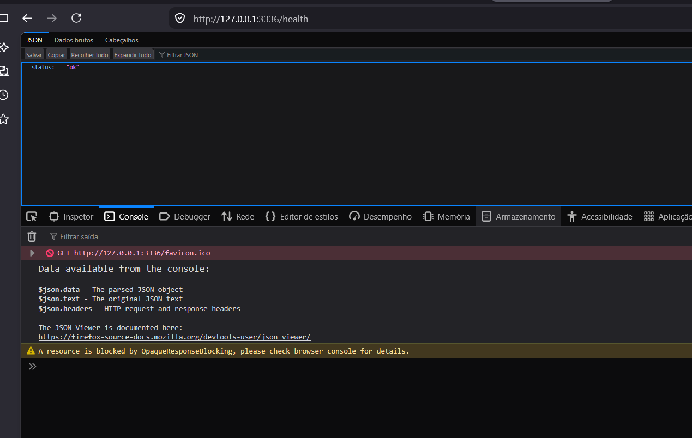
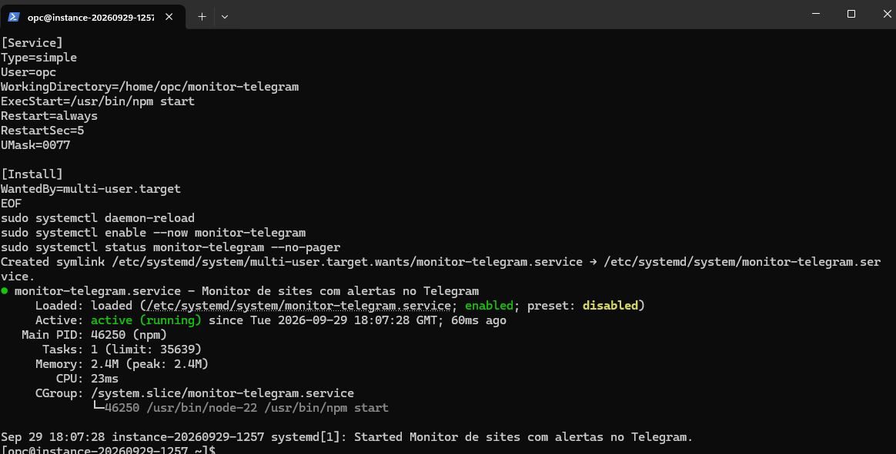

# Monitor de disponibilidade com alertas no Telegram

API em **Node.js, TypeScript e Express** que verifica URLs, registra mudanças de estado e envia alertas de queda e recuperação pelo Telegram. O projeto atualmente funcicona em uma VM Oracle Cloud.

O alvo `/demo-target` permite simular uma indisponibilidade para demonstrar o fluxo sem derrubar um site de verdade.

## Como funciona

1. Você cadastra uma URL com `POST /sites`.
2. A API faz verificações periódicas (padrão: 60 segundos) ou sob demanda com `POST /sites/:id/check`.
3. Respostas HTTP menores que 400 são consideradas disponíveis, as demais, indisponíveis.
4. A primeira verificação estabelece o estado inicial. Uma mudança posterior gera um evento e um alerta **CAIU** ou **VOLTOU**.
5. Os sites e eventos são armazenados no arquivo indicado por `DATA_FILE`.

A API escuta em `127.0.0.1:3335`. Na VM, acesse-a pelo túnel SSH, sem expor a porta 3335 à internet.

## Requisitos

- Node.js 20 ou superior e npm.
- Um bot do Telegram criado com [@BotFather](https://t.me/BotFather).
- Para implantação na nuvem: VM Oracle Linux, IP público, chave SSH privada e acesso à porta 22 restrito ao seu IP sempre que possível.
- PowerShell no Windows para os comandos de exemplo.

## 1. Configuração local no Windows

Abra o PowerShell dentro da pasta do projeto:

```powershell
node --version
npm ci
Copy-Item .env.example .env
notepad .env
```

Preencha o arquivo `.env`:

```dotenv
API_KEY=uma-frase-longa-e-aleatoria-criada-por-voce
TELEGRAM_BOT_TOKEN=token-do-seu-bot
TELEGRAM_CHAT_ID=id-numerico-da-conversa
PORT=3335
CHECK_INTERVAL_SECONDS=60
DATA_FILE=./data/sites.json
```

No Telegram, abra o seu bot e envie `/start`. Para obter o ID da conversa, execute no PowerShell:

```powershell
$botToken = Read-Host 'Cole o token do bot'
$updates = Invoke-RestMethod "https://api.telegram.org/bot$botToken/getUpdates"
$updates.result | ForEach-Object { $_.message.chat.id }
```

Copie o número retornado para `TELEGRAM_CHAT_ID`. Se não aparecer nada, confirme que enviou uma mensagem ao bot e que outro processo não está consumindo as atualizações. Não imprima nem publique o token. Se um token foi compartilhado em uma captura ou conversa pública, revogue-o no BotFather e gere outro.

Confira o código e inicie a API:

```powershell
npm run check
npm run dev
```

Deixe esse terminal aberto. Em outro PowerShell, confira `http://127.0.0.1:3335/health`.

## 2. Demonstração local: queda e recuperação

Em um segundo PowerShell, na pasta do projeto:

```powershell
$base = 'http://127.0.0.1:3335'
$apiKey = (Get-Content .env | Where-Object { $_ -match '^API_KEY=' }) -replace '^API_KEY=', ''
$headers = @{ 'x-api-key' = $apiKey }

Invoke-RestMethod "$base/health"
$site = Invoke-RestMethod "$base/sites" -Method Post -Headers $headers -ContentType 'application/json' -Body '{"name":"Demo pessoal","url":"http://127.0.0.1:3335/demo-target"}'
$site
Invoke-RestMethod "$base/sites/$($site.id)/check" -Method Post -Headers $headers

Invoke-RestMethod "$base/demo-target/state" -Method Post -Headers $headers -ContentType 'application/json' -Body '{"down":true}'
Invoke-RestMethod "$base/sites/$($site.id)/check" -Method Post -Headers $headers

Invoke-RestMethod "$base/demo-target/state" -Method Post -Headers $headers -ContentType 'application/json' -Body '{"down":false}'
Invoke-RestMethod "$base/sites/$($site.id)/check" -Method Post -Headers $headers
Invoke-RestMethod "$base/events" -Headers $headers
```

O primeiro `check` não envia alerta: ele cria a referência. Os dois seguintes devem registrar **CAIU** (HTTP 503) e **VOLTOU** (HTTP 200), com mensagens no Telegram quando o bot estiver configurado.

## 3. Criar uma VM na Oracle Cloud

No [Console OCI](https://cloud.oracle.com/), acesse **Compute > Instances > Create instance**. Consulte o [guia oficial para criar uma instância](https://docs.oracle.com/en-us/iaas/Content/Compute/Tasks/launchinginstance.htm).

1. Selecione **Oracle Linux 9** como imagem e uma shape disponível no seu limite e região (por exemplo, Ampere A1 Flex, arquitetura ARM).
2. Escolha uma VCN/sub-rede pública e atribua um IP público.
3. Gere ou envie uma chave SSH pública e **salve a chave privada** no Windows. Nunca publique a chave privada.
4. Permita entrada TCP **22** para o seu IP público na lista de segurança ou NSG. Evite `0.0.0.0/0` para SSH.
5. Crie a instância e anote o IP público. Não é necessário abrir a porta 3335.

Em um PowerShell **no Windows**, teste a conexão, substituindo nomes e IP pelos seus:

```powershell
ssh -i .\ssh-key-2026-09-29.key opc@IP_PUBLICO_DA_VM
```

Se ocorrer `Connection timed out`, verifique IP público, rota da sub-rede e regra TCP 22. Se ocorrer `Permission denied (publickey)`, confirme o usuário `opc` e a chave privada associada à VM. Veja o [guia de solução de problemas de SSH da OCI](https://docs.oracle.com/pt-br/iaas/Content/Compute/Tasks/troubleshooting-ssh-connection.htm).

## 4. Instalar Node.js na VM

Os comandos a seguir são executados **dentro da sessão SSH**, no Oracle Linux 9:

```bash
cat /etc/os-release
uname -m
sudo dnf module install -y nodejs:22
sudo dnf install -y unzip nano
node --version
npm --version
```

O projeto exige Node.js 20+. Se o módulo `nodejs:22` não estiver disponível na imagem, consulte os [Application Streams do Oracle Linux 9](https://docs.oracle.com/en/operating-systems/oracle-linux/product-lifecycle/ol9_application_streams.html) e instale uma versão suportada antes de continuar.

## 5. Copiar o projeto para a VM

No **PowerShell do Windows**, dentro de `monitor-telegram`, crie um pacote sem `.env`, chaves SSH, dados locais ou `node_modules`:

```powershell
Compress-Archive -LiteralPath .\src,.\package.json,.\package-lock.json,.\tsconfig.json,.\.env.example -DestinationPath .\monitor-telegram-seguro.zip -Force
tar -tf .\monitor-telegram-seguro.zip
scp -i .\ssh-key-2026-09-29.key .\monitor-telegram-seguro.zip opc@IP_PUBLICO_DA_VM:~/
```

O `scp` roda no Windows, onde estão o ZIP e a chave. De volta à **VM por SSH**:

```bash
mkdir -p ~/monitor-telegram
unzip -o ~/monitor-telegram-seguro.zip -d ~/monitor-telegram
cd ~/monitor-telegram
npm ci
cp .env.example .env
chmod 600 .env
nano .env
npm run check
npm start
```

Preencha o `.env` da VM com os valores corretos; ele não foi enviado no ZIP. O servidor deve informar `Monitor ouvindo em http://127.0.0.1:3335`. `npm start` ocupa o terminal até você encerrá-lo com Ctrl+C.

## 6. Testar a API da VM pelo túnel SSH

Com a API em execução na VM, abra **outro PowerShell no Windows**:

```powershell
ssh -i .\ssh-key-2026-09-29.key -L 3336:127.0.0.1:3335 opc@IP_PUBLICO_DA_VM
```

Deixe o túnel aberto. No navegador do Windows, visite [http://127.0.0.1:3336/health](http://127.0.0.1:3336/health). O retorno esperado é `{"status":"ok"}`.



Para testar as rotas a partir do Windows, repita a seção 2 com `$base = 'http://127.0.0.1:3336'`. **A URL cadastrada para o alvo de demonstração continua sendo `http://127.0.0.1:3335/demo-target`**, pois é a VM que faz a verificação. Em uma instância nova, cadastre novamente o site: os dados locais não são copiados no ZIP.

## 7. Manter a API ativa com systemd

Depois de encerrar o `npm start` manual com Ctrl+C, na **VM** crie o serviço:

```bash
sudo nano /etc/systemd/system/monitor-telegram.service
```

Cole o conteúdo:

```ini
[Unit]
Description=Monitor de sites com alertas no Telegram
Wants=network-online.target
After=network-online.target

[Service]
Type=simple
User=opc
WorkingDirectory=/home/opc/monitor-telegram
ExecStart=/usr/bin/npm start
Restart=always
RestartSec=5
UMask=0077

[Install]
WantedBy=multi-user.target
```

Salve e execute:

```bash
sudo systemctl daemon-reload
sudo systemctl enable --now monitor-telegram
sudo systemctl status monitor-telegram --no-pager
```

O estado esperado é `active (running)`. Se houver falha, veja os logs:

```bash
sudo journalctl -u monitor-telegram -n 80 --no-pager
```



Com o serviço ativo, o túnel da seção 6 continua sendo necessário para acessar a API pelo Windows. A verificação periódica e os alertas continuam na VM mesmo depois que você fecha o SSH.

## 8. Registrar uma URL pública para um teste simples

Uma opção pública de demonstração é [https://httpbin.org/status/200](https://httpbin.org/status/200). Com o túnel aberto:

```powershell
$base = 'http://127.0.0.1:3336'
$apiKey = 'valor-de-API_KEY-na-VM'
$headers = @{ 'x-api-key' = $apiKey }
$site = Invoke-RestMethod "$base/sites" -Method Post -Headers $headers -ContentType 'application/json' -Body '{"name":"HTTPBin - exemplo público","url":"https://httpbin.org/status/200"}'
Invoke-RestMethod "$base/sites/$($site.id)/check" -Method Post -Headers $headers
Invoke-RestMethod "$base/sites" -Headers $headers
```

Esse endereço é de terceiros e pode oscilar; use-o apenas como exemplo. Um `200` comprova o registro e a verificação, mas **não gera alerta de queda**. Para mostrar os dois alertas em vídeo, use o alvo controlado da seção 2, adaptando a porta conforme a seção 6.

## Rotas

| Método | Rota | Uso | Chave de API |
| --- | --- | --- | --- |
| GET | `/health` | Estado da API | Não |
| GET | `/demo-target` | Alvo de demonstração | Não |
| POST | `/demo-target/state` | Alterna `{"down":true/false}` | Sim |
| GET | `/sites` | Lista sites | Sim |
| POST | `/sites` | Cadastra `{"name":"...","url":"https://..."}` | Sim |
| DELETE | `/sites/:id` | Remove um site | Sim |
| POST | `/sites/:id/check` | Verifica imediatamente | Sim |
| GET | `/events` | Lista eventos recentes | Sim |

Envie a chave no cabeçalho `x-api-key`. O histórico mantém até 100 eventos no arquivo JSON. O estado do alvo de demonstração fica apenas na memória e volta ao padrão disponível quando a API reinicia.

## Referências

- [Oracle Cloud: criar uma instância](https://docs.oracle.com/en-us/iaas/Content/Compute/Tasks/launchinginstance.htm)
- [Oracle Cloud: resolver problemas de conexão SSH](https://docs.oracle.com/pt-br/iaas/Content/Compute/Tasks/troubleshooting-ssh-connection.htm)
- [Oracle Linux 9: Application Streams](https://docs.oracle.com/en/operating-systems/oracle-linux/product-lifecycle/ol9_application_streams.html)
- [Telegram BotFather](https://t.me/BotFather)
- [HTTPBin](https://httpbin.org/)
